# MediAgenda

Sistema de gestión para clínicas y consultorios (medicina general, odontología y psicología): agenda con arrastrar y soltar, reserva de citas en línea, expediente clínico electrónico, recetas en PDF con QR, cobros, inventario y dashboard.

Gran parte de las reglas importantes están en **PostgreSQL** y no solo en la API: aunque alguien se conecte directo a la base, no puede encimar citas, editar una nota firmada ni borrar la bitácora.

**Stack:** Python 3 · FastAPI · PostgreSQL 17 (pgcrypto, btree_gist) · React 19 · Vite · TailwindCSS 4 · FullCalendar · Recharts · Docker Compose

> 📘 **¿Cómo se hizo?** La explicación completa del código, paso a paso, está en [docs/COMO-SE-HIZO.md](docs/COMO-SE-HIZO.md).

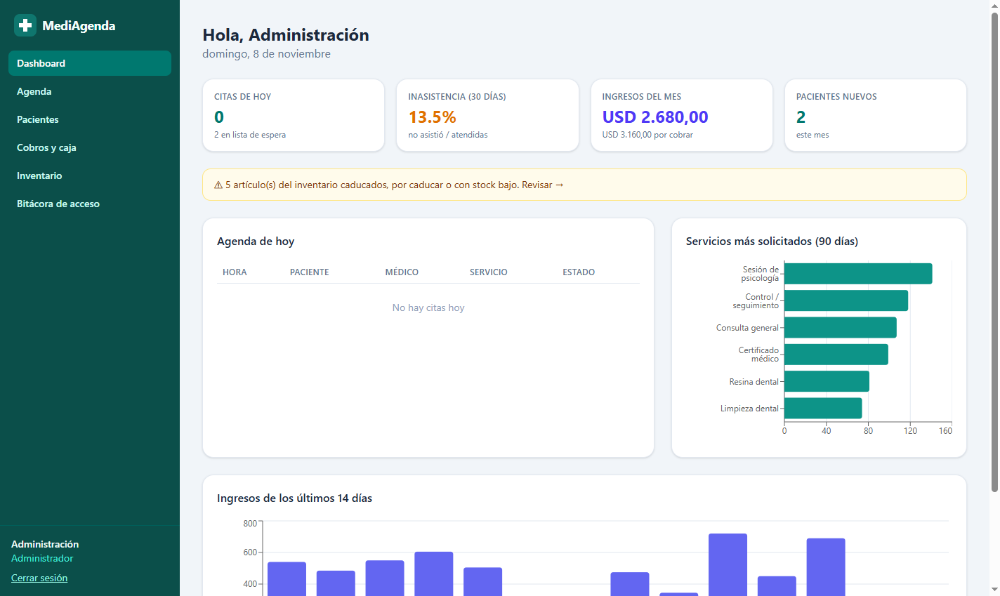

## Capturas

| Agenda con arrastrar y soltar | Expediente clínico (SOAP, CIE-10, signos vitales) |
|---|---|
| 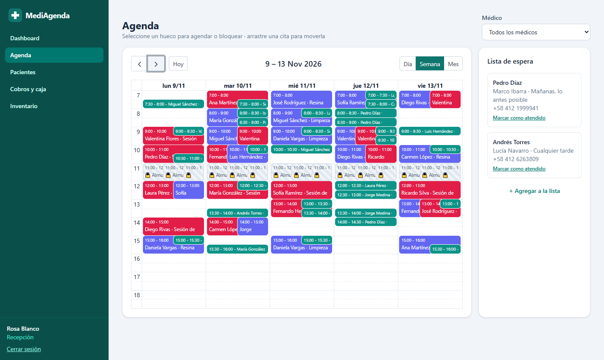 | 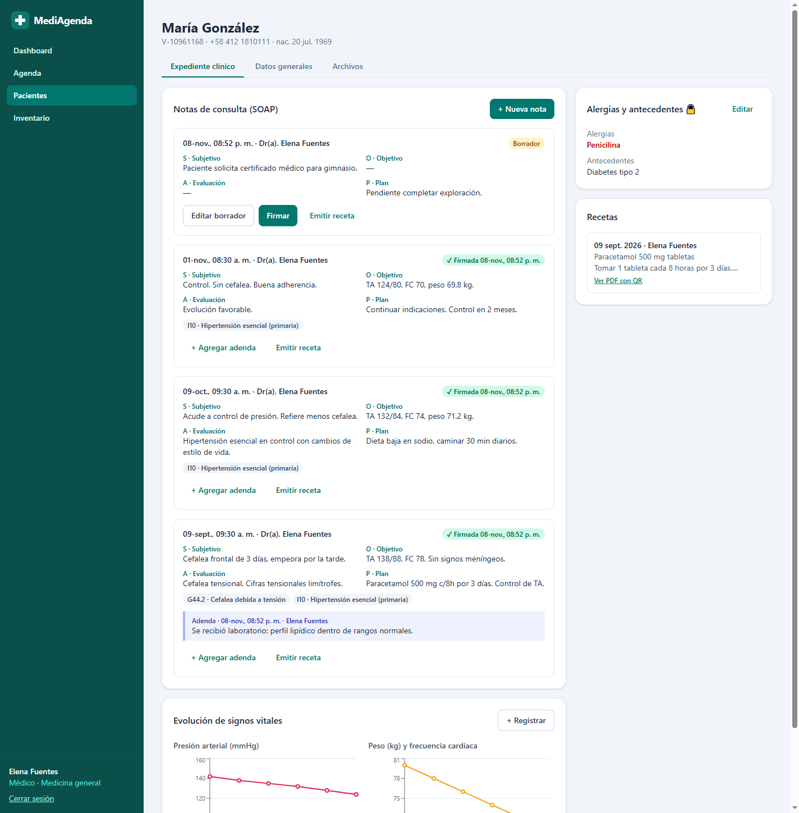 |
| **Reserva en línea del paciente** | **Recepción: sin acceso al contenido clínico** |
| 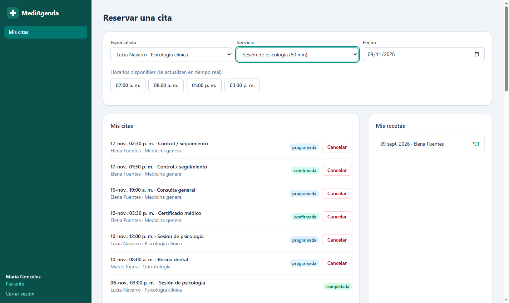 | 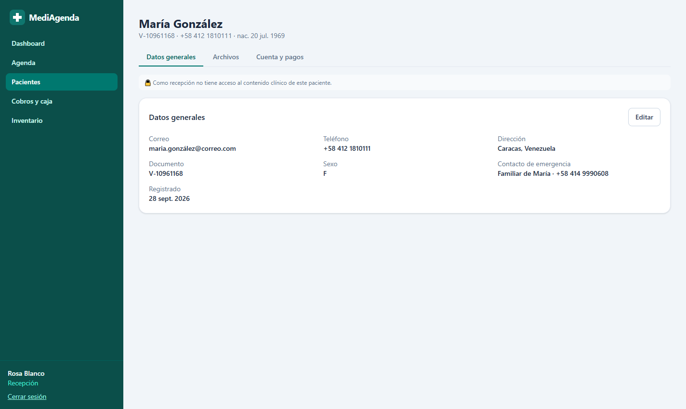 |
| **Corte de caja y saldos** | **Inventario con alertas de caducidad** |
| 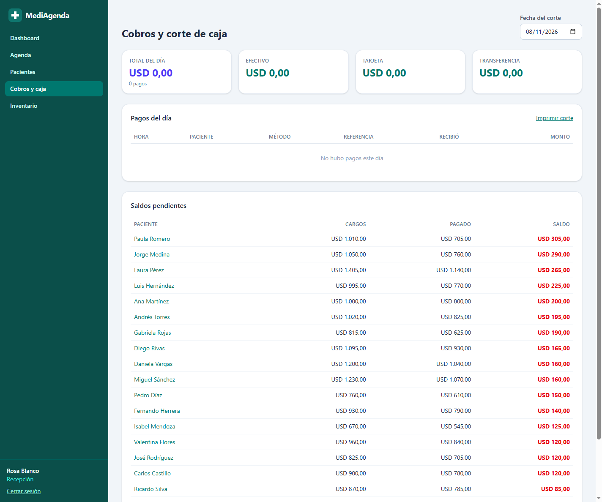 | 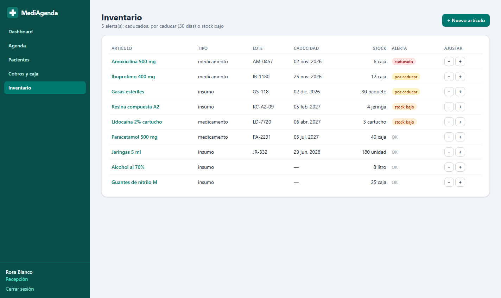 |
| **Bitácora de acceso a expedientes** | **Verificación pública de receta (QR)** |
| 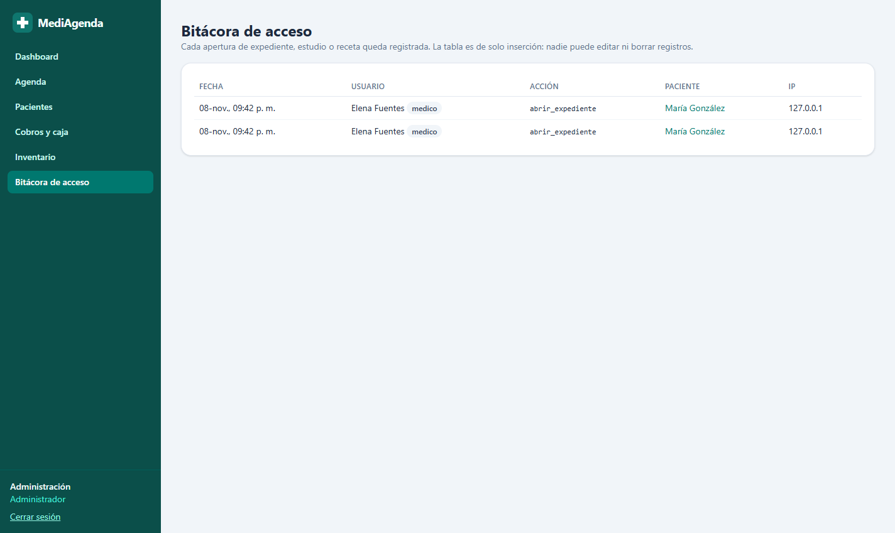 | 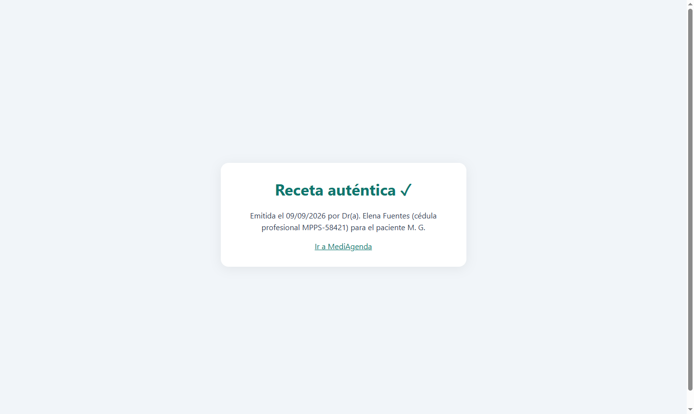 |
| **Vista mensual** | **API documentada (Swagger)** |
| 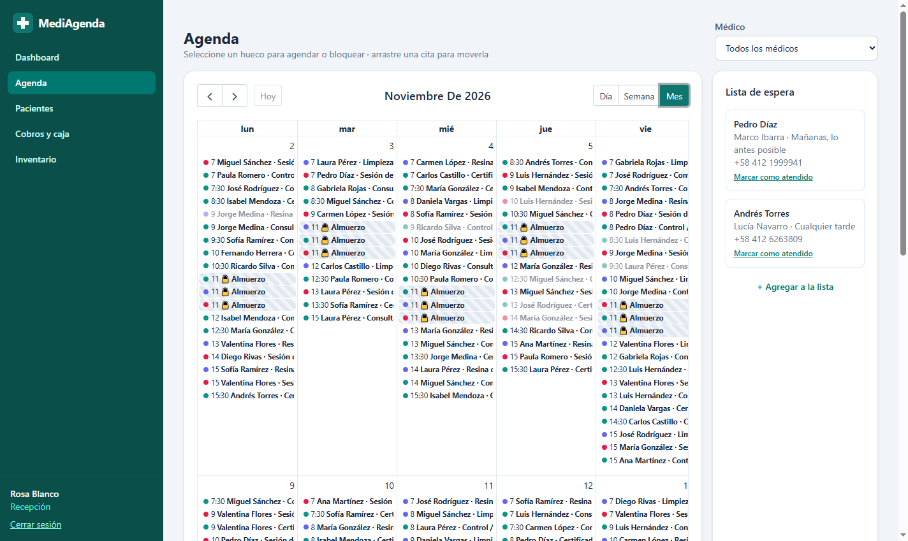 | 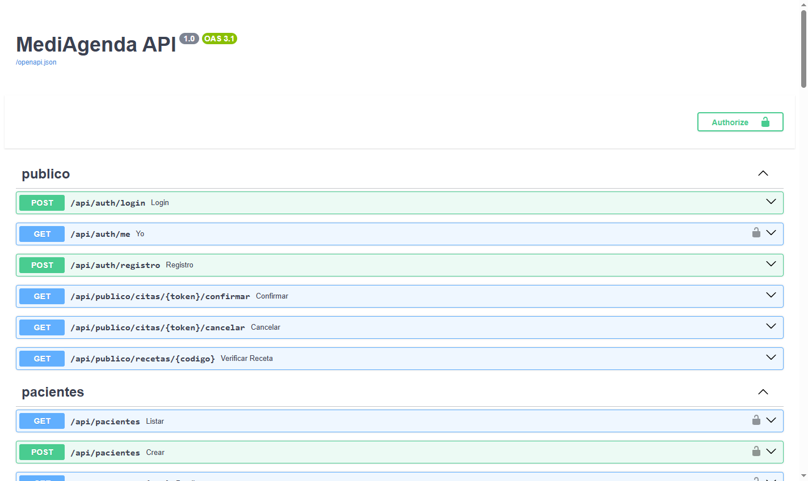 |

<p align="center">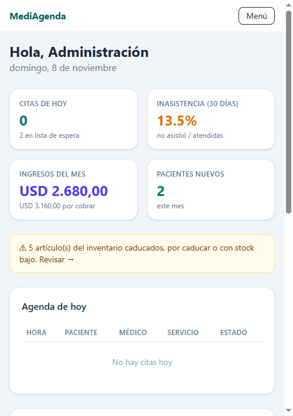<br><em>Diseño adaptable a celular</em></p>

---

## Funcionalidades

| Módulo | Qué hace |
|---|---|
| **Pacientes** | Datos generales, contacto de emergencia, alergias, antecedentes y archivos adjuntos (documentos administrativos o estudios clínicos). |
| **Agenda** | Vista diaria, semanal y mensual por médico; arrastrar y soltar para reprogramar; bloqueos de horario; lista de espera, con sugerencia automática de pacientes cuando se cancela una cita. |
| **Reserva en línea** | El paciente se registra, elige especialista y servicio, y ve los horarios libres calculados por PostgreSQL. La lista se actualiza cada 15 s. |
| **Recordatorios** | Un proceso en segundo plano envía un correo 24 h antes de la cita, con enlaces para confirmar o cancelar. También tiene un punto de integración opcional para WhatsApp (`WHATSAPP_API_URL`). |
| **Expediente clínico** | Notas en formato SOAP con diagnósticos del catálogo CIE-10, firma digital, adendas y signos vitales con gráficas de evolución. |
| **Recetas** | PDF con los datos del médico, su cédula profesional y un código QR que lleva a una página pública de verificación. |
| **Facturación** | Catálogo de servicios, cargo automático al marcar una cita como atendida, pagos, saldos pendientes y corte de caja diario. |
| **Inventario** | Medicamentos e insumos con lote y fecha de caducidad. Avisa cuando algo está caducado, caduca en menos de 30 días o tiene poco stock. |
| **Roles** | Administrador, médico, recepcionista y paciente. **Recepción no ve contenido clínico.** |
| **Dashboard** | Citas del día, tasa de inasistencia, ingresos del mes, pacientes nuevos y servicios más solicitados. |

---

## Seguridad y base de datos

### 1. Cifrado en reposo con pgcrypto

Los campos sensibles se guardan como `bytea` cifrado con `pgp_sym_encrypt` (AES-256). La clave **no se guarda en la base de datos**: la API la envía al abrir cada conexión (`set_config('app.clave_cifrado', …)`) y las funciones `cifrar()` / `descifrar()` la leen de ahí. Si alguien roba un respaldo o entra a la base sin pasar por la API, solo ve bytes ilegibles. Y si falta la clave, `descifrar()` da error en vez de devolver el dato en claro.

| Campo cifrado | Por qué |
|---|---|
| `pacientes.documento_cif` | La cédula o pasaporte permite el robo de identidad. |
| `pacientes.alergias_cif`, `antecedentes_cif` | Son datos de salud, la categoría más sensible. |
| `notas_clinicas.subjetivo/objetivo/evaluacion/plan_cif` | Es el contenido de la consulta: diagnósticos, salud mental, etc. |
| `adendas.texto_cif`, `recetas.medicamentos_cif` | Revelan el tratamiento y, por lo tanto, la enfermedad. |

**No se cifran** el nombre, el correo y el teléfono. Hacen falta para buscar pacientes, enviar recordatorios y llamar desde recepción, y no revelan nada sobre la salud. Cifrarlos impediría usar índices y búsquedas. Las contraseñas no se cifran sino que se guardan con *hash* bcrypt (`crypt(..., gen_salt('bf'))`), y la verificación también ocurre dentro de PostgreSQL.

### 2. Sin citas encimadas: `EXCLUDE` con `tstzrange`

```sql
rango tstzrange NOT NULL,           -- [inicio, fin)
CONSTRAINT cita_sin_solape_medico
  EXCLUDE USING gist (medico_id WITH =, rango WITH &&)
  WHERE (estado <> 'cancelada')
```

- Cada cita guarda su horario como un **rango de tiempo** `[inicio, fin)`. El corchete incluye el inicio y el paréntesis excluye el fin, así que una cita de 9:00 a 9:30 y otra de 9:30 a 10:00 **no** chocan.
- `EXCLUDE` es como un `UNIQUE` generalizado: no puede haber dos filas para las que **todas** las comparaciones sean verdaderas. Aquí significa «mismo médico (`=`) **y** rangos que se solapan (`&&`)».
- Usa un índice **GiST**, que entiende los rangos. La extensión `btree_gist` permite usar `=` sobre enteros dentro del mismo índice.
- El `WHERE` hace que las citas canceladas no ocupen espacio, así que el horario queda libre de nuevo.
- Los **bloqueos** (almuerzo, congresos) están en la misma tabla, por lo que la misma regla impide agendar encima de ellos. Hay una segunda restricción igual por consultorio.
- Si dos pacientes reservan el mismo horario a la vez, PostgreSQL garantiza que solo una inserción gana. La otra recibe `ExclusionViolation`, que la API convierte en un error HTTP 409.

### 3. Notas clínicas firmadas inmutables

Un trigger `BEFORE UPDATE OR DELETE` rechaza cualquier cambio a una nota con `firmada = true`, y al firmar sella `firmada_en`. Las correcciones se hacen con **adendas**, que solo se aceptan en notas firmadas y a su vez no se pueden modificar. Los diagnósticos de una nota firmada tampoco se pueden cambiar.

### 4. Bitácora de acceso

Cada vez que alguien abre un expediente, un estudio clínico o una receta, se inserta una fila en `bitacora_acceso` con el usuario, el paciente, la acción, la IP y la hora. Unos triggers bloquean `UPDATE`, `DELETE` y `TRUNCATE`, así que ni el administrador puede borrar los registros. El administrador los consulta en *Bitácora de acceso*.

### 5. Roles: recepción sin contenido clínico

- La API tiene dos grupos de permisos, `STAFF` y `CLINICO`. Expediente, CIE-10, estudios y recetas exigen `CLINICO` (médico o administrador).
- La consulta de datos generales del paciente no selecciona las columnas clínicas.
- Recepción solo puede subir y ver archivos de categoría `documento`, nunca `estudio`.
- El paciente solo ve sus propias citas y recetas.

### 6. Respaldos automáticos

El servicio `backup` de `docker-compose.yml` ejecuta `pg_dump -Fc` cada 24 h (`BACKUP_INTERVAL`), guarda el archivo en `./backups` y conserva los 7 más recientes. Para restaurar:

```bash
docker exec -i mediagenda_db pg_restore -U mediagenda -d mediagenda --clean < backups/mediagenda_AAAAMMDD_HHMMSS.dump
```

---

## Cómo ejecutarlo

Requisitos: Docker Desktop, Python 3.12+ y Node 20+.

```bash
# 1. Base de datos + respaldos (puerto 5435)
docker compose up -d

# 2. Backend (puerto 8010)
cd backend
python -m venv .venv
.venv\Scripts\activate          # Windows  (Linux/Mac: source .venv/bin/activate)
pip install -r requirements.txt
copy .env.example .env          # cambia CLAVE_CIFRADO y JWT_SECRET
python -m app.seed --reset      # carga los datos de demostración
uvicorn app.main:app --port 8010

# 3. Frontend (puerto 5200)
cd frontend
npm install
npm run dev
```

Abre <http://localhost:5200>. La documentación interactiva de la API está en <http://localhost:8010/docs>.

### Cuentas de demostración

| Rol | Correo | Contraseña |
|---|---|---|
| Administrador | admin@mediagenda.com | admin123 |
| Médico (Medicina general) | dra.fuentes@mediagenda.com | medico123 |
| Médico (Odontología) | dr.ibarra@mediagenda.com | medico123 |
| Médico (Psicología) | psic.navarro@mediagenda.com | medico123 |
| Recepción | recepcion@mediagenda.com | recepcion123 |
| Paciente | maria.gonzalez@correo.com | paciente123 |

Sugerencia: entra como médico y abre a **María González** para ver notas firmadas, una adenda, gráficas de signos vitales y una receta con QR. Luego entra como recepción y comprueba que su expediente no está disponible.

Sin SMTP configurado, los recordatorios se guardan como archivos `.eml` en `backend/outbox/` para poder revisarlos.

### Pruebas

```bash
cd backend
pytest
```

Son 16 pruebas que corren contra una base aparte (`mediagenda_test`). Verifican:

- citas encimadas, bloqueos y horarios liberados al cancelar;
- reservas simultáneas;
- roles;
- bitácora y su inmutabilidad;
- notas firmadas y adendas;
- cifrado real en disco;
- el PDF de la receta y su verificación;
- cargos, saldos y corte de caja;
- inventario;
- recordatorios con enlaces de confirmar y cancelar.

---

## Estructura

```
mediagenda/
├── docker-compose.yml      PostgreSQL + servicio de respaldos
├── db/init/                Esquema (tablas, EXCLUDE, triggers, cifrado) y catálogo CIE-10
├── db/backup.sh            pg_dump programado con rotación
├── backend/app/
│   ├── main.py             FastAPI y traducción de errores de PostgreSQL a HTTP
│   ├── db.py               Pool de conexiones con la clave de cifrado por sesión
│   ├── auth.py             JWT y roles
│   ├── routers/            pacientes, agenda, expediente, gestion, publico
│   ├── pdf.py              Receta en PDF con QR
│   ├── recordatorios.py    Envío automático de recordatorios
│   └── seed.py             Datos de demostración
└── frontend/src/pages/     Dashboard, Agenda, Pacientes, Paciente, Caja, Inventario, Bitácora, Portal
```

## Posibles mejoras

- Cifrar también los archivos adjuntos en disco.
- Gestionar la clave de cifrado con un servicio dedicado (Vault o KMS) y rotarla.
- Agregar Row-Level Security de PostgreSQL como segunda capa de permisos.
- Enviar WhatsApp a través de un proveedor real.
